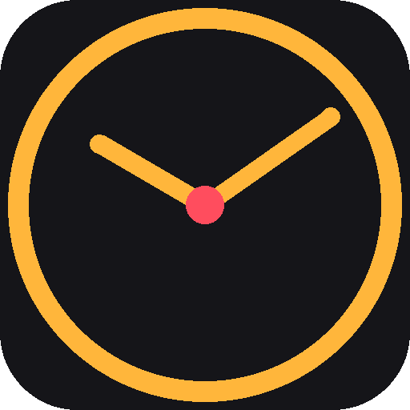
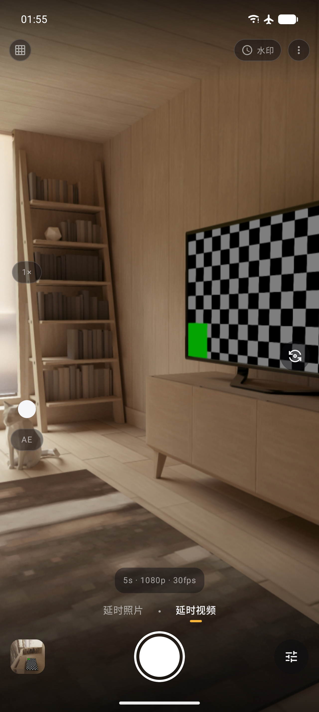
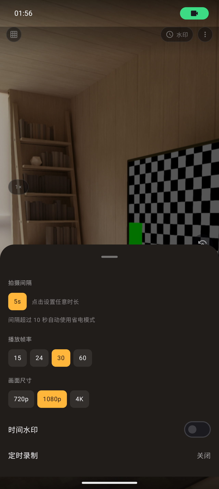
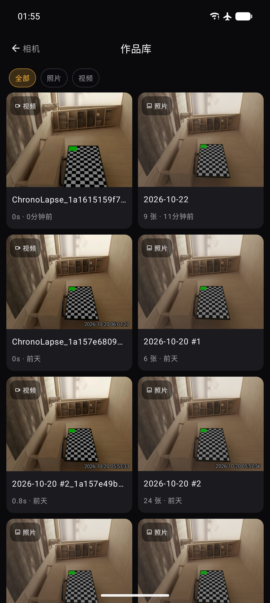
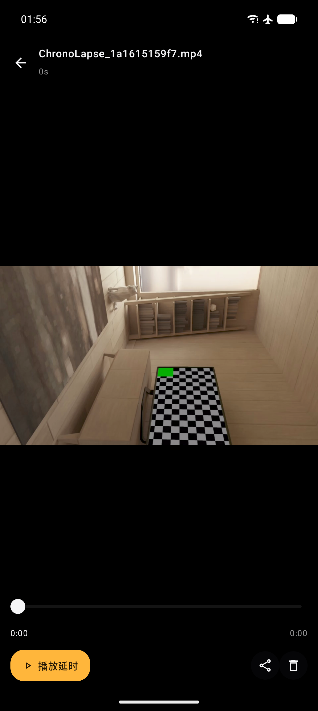

# ChronoLapse

<p align="center">
  简体中文 | <a href="README_en.md">English</a>
</p>

<p align="center">
  
</p>

<p align="center">
  <strong>一款界面像相机的 Android 延时摄影应用</strong><br>
  Kotlin + Jetpack Compose 打造 · 延时照片 / 延时视频双模式 · 时间水印 · 内置作品库
</p>

<p align="center">
  <a href="#安装"></a>
  <a href="#构建"></a>
  
  
  <a href="LICENSE"></a>
</p>

---

<p align="center">
  
  
  
  
</p>

## 特性

### 相机化拍摄

- **全屏取景器**，像原生相机一样操作：双指缩放、点击对焦、AE 芯片调整曝光，左侧竖向滑杆快速变焦
- **双模式滑块**：延时照片（JPG 序列）/ 延时视频（自动硬件编码合成 MP4），只做延时，不做别的
- **任意拍摄间隔**：时 / 分 / 秒滚轮自由组合，1 秒到 23 小时 59 分
- **录制状态一目了然**：REC 计时、已拍帧数、下一帧倒计时、预计成品时长
- 构图网格、时间水印、闪光灯一键开关

### 作品库

- 延时照片按拍摄会话**聚合为项目**，视频平铺展示，全部 / 照片 / 视频筛选
- 项目查看器：**实时拖动**逐帧浏览、按帧率连播预览、单帧步进微调
- 一键将照片序列**合成导出 MP4**，支持分享与批量删除

### 无人值守

- 前台服务 + WakeLock，锁屏熄屏持续拍摄
- **定时录制**：设定未来时间自动开始
- **省电模式**：拍摄间隔 > 10 秒时自动改用系统闹钟逐拍唤醒
- 电量过低 / 存储不足自动停止

### 其它

- **时间水印**：每一帧叠加当前时间，白字黑边随分辨率自适应
- **REST API**：局域网 HTTP 远程启停录制（`http://<IP>:8085`）
- 现代存储：Android 10+ 通过 MediaStore 直写相册，无需存储权限
- 简体中文 / English 跟随系统语言

## 安装

从 [Releases](../../releases) 下载 APK 安装（要求 Android 8.0+）。

首次启动请授予相机、麦克风、通知与照片权限，并允许「忽略电池优化」（无人值守录制必需）。

## 构建

使用 Android Studio（Ladybug 或更新版本）打开项目直接构建，或命令行：

```bat
gradlew assembleRelease
```

正式签名：项目根目录放置 `keystore.properties`（含 `storeFile` / `storePassword` / `keyAlias` / `keyPassword`），未放置时 release 包为未签名。

## 使用说明

1. 底部滑块选择**延时照片**或**延时视频**模式
2. 点击右侧参数按钮调整拍摄间隔（时/分/秒滚轮）、播放帧率、画面尺寸、时间水印；定时录制也在这里设置
3. 更多选项（相机选择、静音快门、自动停止、REST API 等）在右上角 **⋮ 设置** 中
4. 点击快门开始 / 停止；录制中可锁屏，REC 计时与帧数实时显示
5. 快门左侧缩略图进入**作品库**：长按进入多选删除，点开项目可逐帧查看、播放预览或合成导出视频
6. 成果文件位置：延时视频 `Movies/ChronoLapse/<日期>/`，延时照片 `Pictures/ChronoLapse/<日期>/`

## 致谢与许可

本项目基于以下 GPL 项目彻底重构而来，感谢原作者：

- [SpartanTimeLapseRecorder](https://github.com/zeitgeist87/SpartanTimeLapseRecorder) — zeitgeist87
- [TimeLapseCamera](https://github.com/woheller69/TimeLapseCamera) — woheller69

本程序是自由软件，遵循 [GPL-3.0](LICENSE) 许可证发布。

Copyright (C) 2026 Sun-Chenyang
